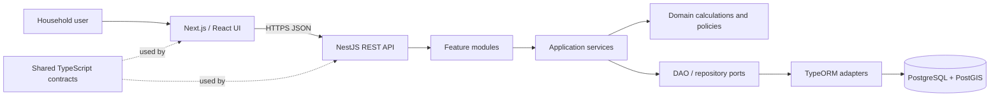

# Architecture at a Glance

The system uses a modular monorepo with a web client, API application, shared contracts, and PostgreSQL. The intended dependency direction is toward domain/application abstractions, not from business rules into web frameworks or database details.

## Frontend
- Next.js App Router and React/TypeScript provide routing, component composition, and typed UI.
- Keep input state and view state in React; isolate pure calculation helpers from rendering.
- Use Canvas for animated rainfall/flow effects and SVG for scalable, labeled static geometry. Keep important data as DOM text so it remains accessible and testable.
- For richer interactions, consider React Hook Form + Zod for form state/validation, TanStack Query for API cache/retries, and a chart library such as Recharts for time-series charts. Add these only when used by actual screens.
- Respect `prefers-reduced-motion`, keyboard interaction, visible focus, and responsive sizing.

## Backend layers
1. **Transport:** controllers, route definitions, DTO validation, HTTP status mapping.
2. **Application:** use cases that coordinate calculation, persistence, and recommendation policies.
3. **Domain:** units, calculation rules, invariants, and pure functions; no NestJS or TypeORM imports.
4. **Ports:** repository/DAO interfaces consumed by application services.
5. **Adapters:** TypeORM entities/repositories, external rainfall provider clients, sensor clients.
6. **Infrastructure:** configuration, logging, database connection, migrations, health checks.

The current starter contains NestJS modules/controllers/services and a generic DAO abstraction. As it matures, move domain rules into framework-independent modules and bind DAO ports to TypeORM adapters through dependency-injection tokens.

## Recommended feature modules
- `ProfilesModule` — user profile and preferences.
- `PropertiesModule` — property/site metadata and roof surfaces.
- `RainfallModule` — observations, forecasts, provider provenance, quality flags.
- `CalculationsModule` — deterministic harvesting and demand calculations.
- `RecommendationsModule` — rule-based advice with rationale and constraints.
- `GreywaterModule` — source volumes, treatment assumptions, reuse demand.
- `SensorsModule` — devices, readings, ingestion and validation.
- `WaterQualityModule` — measured parameters and non-potable suitability flags.
- `HistoryModule` — immutable calculation snapshots and comparison.
- `HealthModule` — readiness/liveness and dependency checks.

## Dependency and design principles
- **SOLID:** single responsibility per module/class; depend on abstractions; avoid controllers owning business rules.
- **DRY without over-generalizing:** share stable logic, but keep feature-specific policy explicit.
- **Composition over inheritance:** use interfaces and injected collaborators; reserve base classes for truly invariant behavior.
- **Generics:** generic DAO and pagination/result types are useful; domain repositories should still expose meaningful methods such as `findByPropertyId` rather than leaking arbitrary ORM query shapes.
- **Strategy pattern:** select rainfall providers or recommendation policies behind interfaces.
- **Factory pattern:** construct validated calculation input snapshots or provider adapters where construction rules are non-trivial.
- **Adapter pattern:** isolate TypeORM and external provider APIs from application logic.
- **Repository/DAO pattern:** isolate persistence. Avoid duplicating both patterns if they do not have distinct responsibilities.
- **Dependency inversion:** domain/application layers must not import controllers or TypeORM entities.

## Calculation flow
1. Validate input ranges and units at the transport boundary.
2. Normalize inputs into a domain input value object.
3. Run pure calculations with explicit assumptions.
4. Return output values, units, and an assumption/provenance block.
5. Persist an immutable snapshot when authenticated persistence is enabled.
6. Generate recommendations from rules that return both action and rationale.

A useful first-order rainwater estimate is:

`harvestable litres = rainfall_mm × roof_area_m² × runoff_coefficient × collection_efficiency`

Because 1 mm of rain on 1 m² equals 1 litre. This is a planning estimate; actual capture depends on first-flush diversion, roof material, conveyance, overflow, rainfall timing, and maintenance.

## Reliability and operations
- Use database migrations for deployed environments; bootstrap SQL is for local initialization.
- Keep credentials in environment/secret management, never source control.
- Add request IDs, structured logs, metrics, readiness checks, and database backup/restore drills before production.
- Use idempotent ingestion for rainfall and sensor readings.
